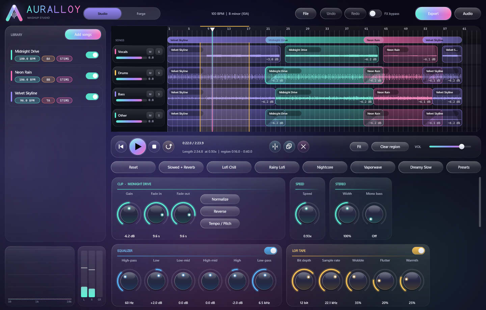

<!-- Generated by tools/readmes.py; edit docs/i18n/locales/es.json. -->
<div align="center">
  
  <h3>Dos canciones entran, una aleación sale.</h3>
  <p>Un estudio de escritorio de código abierto para mashups automáticos basados en reglas, slowed + reverb y lofi, con un editor de línea de tiempo real.</p>
  <p>
    <a href="https://github.com/thecmjhb/Auralloy/releases"></a>
    
    
    
    
    <a href="https://doi.org/10.5281/zenodo.24391795"></a>
  </p>
  <p><a href="#demo">Míralo en acción</a> · <a href="#what">Qué hace</a> · <a href="#start">Primeros pasos</a> · <a href="#rules">Las reglas del mashup</a> · <a href="#bench">Benchmarks</a> · <a href="#paper">Artículo de investigación</a></p>
</div>

---

<p align="center" dir="ltr"><a href="../../README.md" title="English"></a><a href="../../README.bn.md" title="বাংলা"></a><a href="README.zh-CN.md" title="中文"></a><a href="README.hi.md" title="हिन्दी"></a><a href="README.es.md" title="Español"></a><a href="README.ar.md" title="العربية"></a><a href="README.fr.md" title="Français"></a><a href="README.pt.md" title="Português"></a><a href="README.id.md" title="Bahasa Indonesia"></a><a href="README.ur.md" title="اردو"></a><br><a href="README.ru.md" title="Русский"></a><a href="README.ko.md" title="한국어"></a><a href="README.ja.md" title="日本語"></a><a href="README.de.md" title="Deutsch"></a><a href="README.tr.md" title="Türkçe"></a><a href="README.it.md" title="Italiano"></a><a href="README.fa.md" title="فارسی"></a><a href="README.vi.md" title="Tiếng Việt"></a><a href="README.ta.md" title="தமிழ்"></a><a href="README.te.md" title="తెలుగు"></a></p>


<a id="demo"></a>

## 🎬 Míralo en acción

<p align="center"></p>

<p align="center"><sub>Intro, importación, análisis automático, Forge, una mezcla secuencial, Slowed + Reverb con un clic, exportación.</sub></p>

<a id="what"></a>

## ✨ Qué hace

| | |
|---|---|
| 🎛️ **Forge: mashups automáticos** | Elige dos o más canciones. Auralloy iguala tempo y tonalidad y las reproduce una tras otra, al ritmo, con una transición suave en cada cambio. |
| 🔎 **Explicable por diseño** | Cada decisión sigue una regla escrita y se registra en lenguaje claro. Sin cajas negras. |
| 🎚️ **Studio: un editor de verdad** | Línea de tiempo multipista con imán, cortar, recortar, fundidos, invertir, ganancia por clip, tempo y tono, regiones en bucle y deshacer ilimitado. |
| 🌧️ **Slowed + reverb y lofi** | Looks con un clic y un rack completo: EQ, cinta lofi, compresor, chorus, eco, reverb, anchura, lluvia y vinilo. |
| 💎 **Exportación de alta calidad** | WAV 16/24/32 bits float, FLAC y MP3 de 44,1 a 96 kHz, procesado en 32 bits float. |
| 🧪 **Abierto y probado** | AGPL-3.0, pruebas sin interfaz, benchmarks con semilla y un preprint de investigación. |

## 🧭 Cómo funciona

<p align="center"></p>

1. Analiza tempo, pulsos, compases, tonalidad y secciones.
2. Separa stems: voz, batería, bajo, otros.
3. Planifica el arreglo con las reglas y escribe el registro.
4. Renderiza cada clip con tempo y tono igualados.
5. Edita: todo es un clip normal en la línea de tiempo.

<a id="start"></a>

## 🚀 Primeros pasos

1. Descarga <b>Auralloy-0.0.1-windows-x64.zip</b> desde Releases y ejecuta <code>Auralloy.exe</code>.
2. Arrastra dos o más canciones a la ventana.
3. Abre <b>Forge</b> y pulsa la esfera: las canciones suenan una tras otra.
4. Edita en la línea de tiempo, elige un look y <b>Exporta</b>.

> Las instrucciones de compilación, los atajos y la documentación técnica están en el README en inglés.

<a id="rules"></a>

## 📐 Las reglas del mashup

Forge sigue reglas explícitas y escribe un registro en lenguaje claro de cada decisión.

- Un tempo común, con el mínimo estiramiento temporal.
- Una tonalidad común (La menor equivale a Do mayor), con el mínimo cambio de tono.
- Cada corte en un tiempo fuerte, en frases de 4 compases.
- Una voz y un bajo a la vez; el bajo cambia en una línea de compás.
- Secciones emparejadas por energía; transiciones de 2 a 8 compases.
- Cada canción conserva su propio equilibrio y se iguala el nivel.


## 🖥️ Recorrido por el panel

<p align="center"><br><sub>Studio: cinta de canciones, carriles por rol, rack de efectos.</sub></p>

<p align="center"><br><sub>Forge: decks, matriz de compatibilidad y el plan.</sub></p>

<p align="center"><br><sub>Exportar: WAV, FLAC, MP3, normalizar, dither.</sub></p>

<a id="bench"></a>

## 📊 Benchmarks

Con semilla, sintético y reproducible (ver benchmarks/). La música real será más compleja.

| | |
|---|---:|
| Tempo dentro del 0,5 % | **93.8 %** |
| Tonalidad exacta o relativa | **99.0 %** |
| Tiempo fuerte dentro de 50 ms | **85.4 %** |
| Límites de sección (F1) | **0.71** |
| Cumplimiento de reglas | **100.0 %** |
| Error de tempo renderizado | **0.010 BPM** |
| Deriva de tempo frente a crossfade simple | **0.05 vs 3.07 BPM** |

<sub>96 songs · 45 planned mashups · stems SI-SDR vocals 21.9 dB, drums -0.3 dB, bass 6.9 dB · seed 20261101</sub>

## ⚠️ Limitaciones, con honestidad

- Supone un tempo 4/4 bastante estable.
- Quick Stems es DSP clásico, no un separador neuronal.
- La detección de tonalidad puede fallar con armonía ambigua.
- Validado con canciones sintéticas; la música real necesita más pruebas.

<a id="paper"></a>

## 📄 Artículo de investigación

<p align="center"><a href="https://doi.org/10.5281/zenodo.24391795"></a> <a href="../../paper/Auralloy-preprint.pdf"></a></p>

**Auralloy: Rule-Grounded, Explainable Multi-Song Mashup Generation with an Editable Stem Timeline**  
C. M. Jubayer Hossain Bappy · 2026 · [10.5281/zenodo.24391795](https://doi.org/10.5281/zenodo.24391795)

Un preprint de investigación que describe el método y su evaluación está publicado en Zenodo. No ha sido revisado por pares.

<details>
<summary><b>BibTeX</b></summary>

```bibtex
@misc{bappy2026auralloy,
  author    = {Hossain Bappy, C. M. Jubayer},
  title     = {Auralloy: Rule-Grounded, Explainable Multi-Song Mashup Generation with an Editable Stem Timeline},
  year      = {2026},
  publisher = {Zenodo},
  doi       = {10.5281/zenodo.24391795},
  url       = {https://doi.org/10.5281/zenodo.24391795}
}
```

GitHub also shows a *Cite this repository* button (from `CITATION.cff`).

</details>

[CONTRIBUTING](../../CONTRIBUTING.md) · [CHANGELOG](../../CHANGELOG.md) · [SECURITY](../../SECURITY.md)

## ⚖️ Licencia

AGPL-3.0 (construido sobre JUCE). Auralloy es una herramienta: eres responsable de los derechos del audio que importas.


<p align="center"><sub>© C. M. Jubayer Hossain Bappy · <a href="../../LICENSE">AGPL-3.0</a></sub></p>
