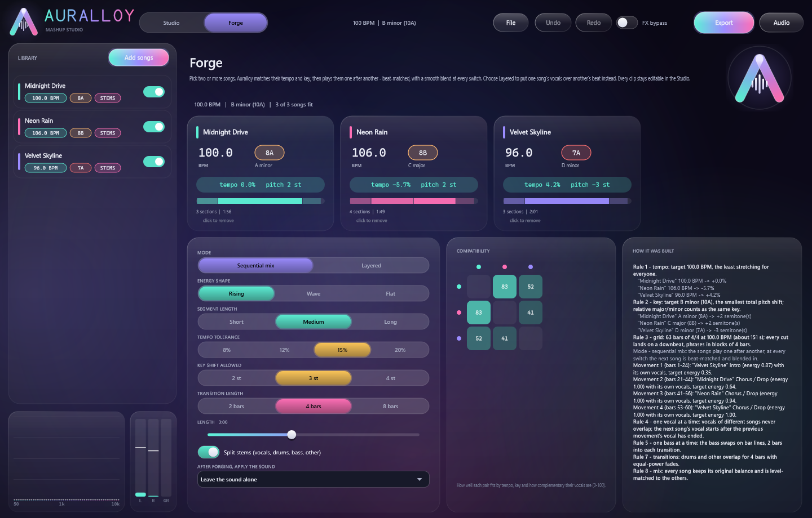

<!-- Generated by tools/readmes.py; edit docs/i18n/locales/fa.json. -->
<div align="center">
  
  <h3>دو آهنگ وارد می‌شود، یک آلیاژ بیرون می‌آید.</h3>
  <p>استودیوی دسکتاپ متن‌باز برای مشاپ خودکار قاعده‌محور، اسلوود + ریورب و لوفای، همراه با ویرایشگر واقعی خط زمانی.</p>
  <p>
    <a href="https://github.com/thecmjhb/Auralloy/releases"></a>
    
    
    
    
    <a href="https://doi.org/10.5281/zenodo.24391795"></a>
  </p>
  <p><a href="#demo">در عمل ببینید</a> · <a href="#what">چه کاری انجام می‌دهد</a> · <a href="#start">شروع کنید</a> · <a href="#rules">قواعد مشاپ</a> · <a href="#bench">بنچمارک</a> · <a href="#paper">مقاله پژوهشی</a></p>
</div>

---

<p align="center" dir="ltr"><a href="../../README.md" title="English"></a><a href="../../README.bn.md" title="বাংলা"></a><a href="README.zh-CN.md" title="中文"></a><a href="README.hi.md" title="हिन्दी"></a><a href="README.es.md" title="Español"></a><a href="README.ar.md" title="العربية"></a><a href="README.fr.md" title="Français"></a><a href="README.pt.md" title="Português"></a><a href="README.id.md" title="Bahasa Indonesia"></a><a href="README.ur.md" title="اردو"></a><br><a href="README.ru.md" title="Русский"></a><a href="README.ko.md" title="한국어"></a><a href="README.ja.md" title="日本語"></a><a href="README.de.md" title="Deutsch"></a><a href="README.tr.md" title="Türkçe"></a><a href="README.it.md" title="Italiano"></a><a href="README.fa.md" title="فارسی"></a><a href="README.vi.md" title="Tiếng Việt"></a><a href="README.ta.md" title="தமிழ்"></a><a href="README.te.md" title="తెలుగు"></a></p>

<div dir="rtl">

<a id="demo"></a>

## 🎬 در عمل ببینید

<p align="center"></p>

<p align="center"><sub>مقدمه، درون‌ریزی، تحلیل خودکار، Forge، میکس پشت‌سرهم، Slowed + Reverb با یک کلیک، خروجی گرفتن.</sub></p>

<a id="what"></a>

## ✨ چه کاری انجام می‌دهد

| | |
|---|---|
| 🎛️ **Forge: مشاپ خودکار** | دو آهنگ یا بیشتر انتخاب کنید. Auralloy تمپو و گام را هماهنگ می‌کند و آهنگ‌ها را پشت‌سرهم، هم‌ضرب، با ترکیب نرم در هر تغییر پخش می‌کند. |
| 🔎 **توضیح‌پذیر از بنیان** | هر تصمیم از یک قاعده مکتوب پیروی می‌کند و به زبان ساده ثبت می‌شود. جعبه سیاه در کار نیست. |
| 🎚️ **Studio: ویرایشگر واقعی** | خط زمانی چندتراکی با چسبندگی، برش، کوتاه‌کردن، فید، معکوس، گین هر کلیپ، تمپو و پیچ، ناحیه تکرار و بازگردانی نامحدود. |
| 🌧️ **Slowed + reverb و lofi** | حالت‌های یک‌کلیکی و رک کامل افکت: EQ، نوار لوفای، کمپرسور، کُرس، پژواک، ریورب، عرض، باران و وینیل. |
| 💎 **خروجی باکیفیت** | WAV با 16/24/32 بیت اعشاری، FLAC و MP3 از 44.1 تا 96 کیلوهرتز، پردازش با 32 بیت اعشاری. |
| 🧪 **باز و آزمایش‌شده** | AGPL-3.0، آزمون‌های بدون رابط، مجموعه بنچمارک با seed ثابت و یک پیش‌چاپ پژوهشی. |

## 🧭 چگونه کار می‌کند

<p align="center"></p>

1. تحلیل تمپو، ضرب، میزان، گام و بخش‌ها.
2. جداسازی استم‌ها: آواز، درامز، بیس، سایر.
3. طرح‌ریزی آرایش با قواعد مشاپ و نوشتن گزارش.
4. رندر هر کلیپ با تمپو و پیچ هماهنگ.
5. ویرایش: همه‌چیز کلیپ معمولی روی خط زمانی است.

<a id="start"></a>

## 🚀 شروع کنید

1. فایل <b>Auralloy-0.0.1-windows-x64.zip</b> را از Releases بگیرید و <code>Auralloy.exe</code> را اجرا کنید.
2. دو آهنگ یا بیشتر را داخل پنجره بیندازید.
3. <b>Forge</b> را باز کنید و روی گوی بزنید: آهنگ‌ها پشت‌سرهم پخش می‌شوند.
4. روی خط زمانی ویرایش کنید، یک حالت انتخاب کنید و <b>Export</b> بزنید.

> راهنمای ساخت، میان‌برها و مستندات فنی در README انگلیسی هستند.

<a id="rules"></a>

## 📐 قواعد مشاپ

Forge از قواعد صریح پیروی می‌کند و برای هر تصمیم گزارشی به زبان ساده می‌نویسد.

- یک تمپوی مشترک، با کمترین کشش زمانی.
- یک گام مشترک (لا مینور برابر دو ماژور)، با کمترین جابه‌جایی پیچ.
- هر برش روی ضرب قوی، در عبارت‌های ۴ میزانی.
- هم‌زمان یک آواز و یک بیس؛ بیس روی خط میزان عوض می‌شود.
- بخش‌ها بر پایه انرژی جفت می‌شوند؛ ترکیب‌های ۲ تا ۸ میزانی.
- هر آهنگ تعادل خود را حفظ می‌کند و بلندی صدا همسان می‌شود.


## 🖥️ گشت در داشبورد

<p align="center"><br><sub>Studio: نوار آهنگ‌ها، خط‌های نقش، رک افکت.</sub></p>

<p align="center"><br><sub>Forge: دک‌ها، ماتریس سازگاری و طرح.</sub></p>

<p align="center"><br><sub>Export: WAV، FLAC، MP3، نرمال‌سازی، دیدر.</sub></p>

<a id="bench"></a>

## 📊 بنچمارک

با seed ثابت، مصنوعی و تکرارپذیر (به benchmarks/ نگاه کنید). موسیقی واقعی پیچیده‌تر خواهد بود.

| | |
|---|---:|
| تمپو در محدوده 0.5 % | **93.8 %** |
| گام دقیق یا نسبی | **99.0 %** |
| ضرب قوی در محدوده 50 ms | **85.4 %** |
| مرز بخش‌ها (F1) | **0.71** |
| رعایت قواعد | **100.0 %** |
| خطای تمپو پس از رندر | **0.010 BPM** |
| رانش تمپو در برابر کراس‌فید ساده | **0.05 vs 3.07 BPM** |

<sub>96 songs · 45 planned mashups · stems SI-SDR vocals 21.9 dB, drums -0.3 dB, bass 6.9 dB · seed 20261101</sub>

## ⚠️ محدودیت‌ها، صادقانه

- تمپوی تقریباً ثابت 4/4 را فرض می‌کند.
- Quick Stems پردازش سیگنال کلاسیک است، نه جداکننده عصبی.
- در هارمونی مبهم ممکن است تشخیص گام اشتباه باشد.
- روی آهنگ‌های مصنوعی اعتبارسنجی شده؛ موسیقی واقعی آزمون بیشتری می‌خواهد.

<a id="paper"></a>

## 📄 مقاله پژوهشی

<p align="center"><a href="https://doi.org/10.5281/zenodo.24391795"></a> <a href="../../paper/Auralloy-preprint.pdf"></a></p>

**Auralloy: Rule-Grounded, Explainable Multi-Song Mashup Generation with an Editable Stem Timeline**  
C. M. Jubayer Hossain Bappy · 2026 · [10.5281/zenodo.24391795](https://doi.org/10.5281/zenodo.24391795)

پیش‌چاپ پژوهشی که روش و ارزیابی را شرح می‌دهد در Zenodo منتشر شده است. داوری همتا نشده است.

<details>
<summary><b>BibTeX</b></summary>

```bibtex
@misc{bappy2026auralloy,
  author    = {Hossain Bappy, C. M. Jubayer},
  title     = {Auralloy: Rule-Grounded, Explainable Multi-Song Mashup Generation with an Editable Stem Timeline},
  year      = {2026},
  publisher = {Zenodo},
  doi       = {10.5281/zenodo.24391795},
  url       = {https://doi.org/10.5281/zenodo.24391795}
}
```

GitHub also shows a *Cite this repository* button (from `CITATION.cff`).

</details>

[CONTRIBUTING](../../CONTRIBUTING.md) · [CHANGELOG](../../CHANGELOG.md) · [SECURITY](../../SECURITY.md)

## ⚖️ مجوز

AGPL-3.0 (ساخته‌شده روی JUCE). Auralloy یک ابزار است: مسئولیت حقوق صوتی که وارد می‌کنید با شماست.

</div>

<p align="center"><sub>© C. M. Jubayer Hossain Bappy · <a href="../../LICENSE">AGPL-3.0</a></sub></p>
