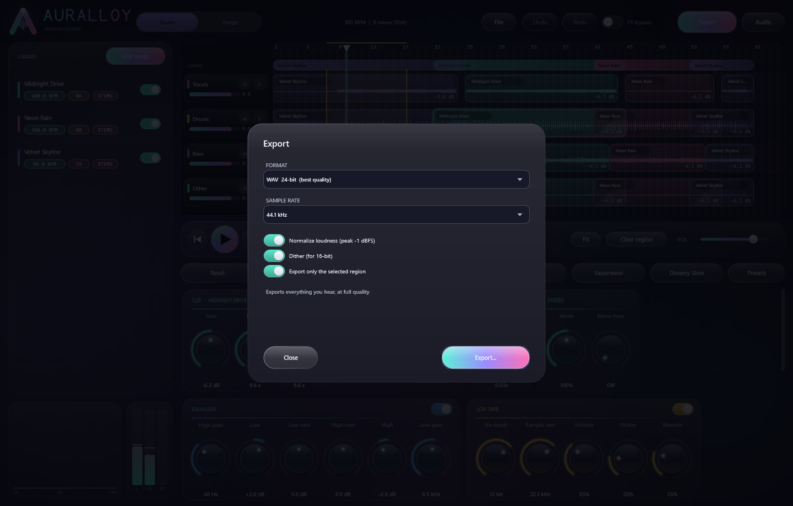

<!-- Generated by tools/readmes.py; edit docs/i18n/locales/fr.json. -->

  
  <h3>Deux morceaux entrent, un alliage sort.</h3>
  
Un studio de bureau open source pour des mashups automatiques basés sur des règles, du slowed + reverb et du lofi, avec un vrai éditeur de timeline.

  

    
    
    
    
    
    
  

  
<a href="#demo">Voir en action</a> · <a href="#what">Ce que ça fait</a> · <a href="#start">Démarrer</a> · <a href="#rules">Les règles du mashup</a> · <a href="#bench">Benchmarks</a> · <a href="#paper">Article de recherche</a>

---

 

## 🎬 Voir en action

Intro, import, analyse automatique, Forge, un mix séquentiel, Slowed + Reverb en un clic, export.

## ✨ Ce que ça fait

| | |
|---|---|
| 🎛️ **Forge : mashups automatiques** | Choisissez deux morceaux ou plus. Auralloy accorde tempo et tonalité puis les enchaîne, calés sur le beat, avec un fondu fluide à chaque transition. |
| 🔎 **Explicable par conception** | Chaque décision suit une règle écrite et est consignée en langage clair. Pas de boîte noire. |
| 🎚️ **Studio : un vrai éditeur** | Timeline multipiste avec aimantation, découpe, rognage, fondus, inversion, gain par clip, tempo et hauteur, régions en boucle et annulation illimitée. |
| 🌧️ **Slowed + reverb et lofi** | Looks en un clic et rack d'effets complet : EQ, bande lofi, compresseur, chorus, écho, réverbération, largeur, pluie et vinyle. |
| 💎 **Export de haute qualité** | WAV 16/24/32 bits flottant, FLAC et MP3 de 44,1 à 96 kHz, traités en 32 bits flottant. |
| 🧪 **Ouvert et testé** | AGPL-3.0, tests sans interface, suite de benchmarks à graine fixe et un preprint de recherche. |

## 🧭 Comment ça marche

1. Analyse du tempo, des temps, des mesures, de la tonalité et des sections.
2. Séparation des stems : voix, batterie, basse, autres.
3. Planification de l'arrangement avec les règles et écriture du journal.
4. Rendu de chaque clip avec tempo et hauteur accordés.
5. Édition : tout est un clip ordinaire sur la timeline.

## 🚀 Démarrer

1. Téléchargez <b>Auralloy-0.0.1-windows-x64.zip</b> depuis Releases et lancez <code>Auralloy.exe</code>.
2. Glissez deux morceaux ou plus dans la fenêtre.
3. Ouvrez <b>Forge</b> et appuyez sur l'orbe : les morceaux s'enchaînent.
4. Éditez sur la timeline, choisissez un look, puis <b>Exportez</b>.

> Les instructions de compilation, les raccourcis et la documentation technique sont dans le README anglais.

## 📐 Les règles du mashup

Forge suit des règles explicites et écrit un journal en langage clair de chaque décision.

- Un tempo commun, avec le moins d'étirement temporel possible.
- Une tonalité commune (la mineur égale do majeur), avec le plus petit décalage de hauteur.
- Chaque coupe sur un premier temps, en phrases de 4 mesures.
- Une seule voix et une seule basse à la fois ; la basse change sur une barre de mesure.
- Sections appariées par énergie ; fondus de 2 à 8 mesures.
- Chaque morceau garde son équilibre et le niveau est homogénéisé.

## 🖥️ Visite du tableau de bord

 Studio : ruban des morceaux, pistes par rôle, rack d&#x27;effets.

 Forge : platines, matrice de compatibilité et plan.

 Export : WAV, FLAC, MP3, normalisation, dither.

## 📊 Benchmarks

À graine fixe, synthétique et reproductible (voir benchmarks/). La vraie musique sera plus complexe.

| | |
|---|---:|
| Tempo à 0,5 % près | **93.8 %** |
| Tonalité exacte ou relative | **99.0 %** |
| Premier temps à 50 ms près | **85.4 %** |
| Limites de sections (F1) | **0.71** |
| Respect des règles | **100.0 %** |
| Erreur de tempo après rendu | **0.010 BPM** |
| Dérive de tempo face à un crossfade naïf | **0.05 vs 3.07 BPM** |

96 songs · 45 planned mashups · stems SI-SDR vocals 21.9 dB, drums -0.3 dB, bass 6.9 dB · seed 20261101

## ⚠️ Limites, en toute honnêteté

- Suppose un tempo 4/4 à peu près stable.
- Quick Stems est du DSP classique, pas un séparateur neuronal.
- La détection de tonalité peut se tromper sur une harmonie ambiguë.
- Validé sur des morceaux synthétiques ; la vraie musique demande plus de tests.

## 📄 Article de recherche

**Auralloy: Rule-Grounded, Explainable Multi-Song Mashup Generation with an Editable Stem Timeline**  
C. M. Jubayer Hossain Bappy · 2026

Un preprint de recherche décrivant la méthode et son évaluation est préparé pour Zenodo. Il n'a pas été évalué par des pairs.

## ⚖️ Licence

AGPL-3.0 (construit sur JUCE). Auralloy est un outil : vous êtes responsable des droits sur l'audio que vous importez.

© C. M. Jubayer Hossain Bappy · <a href="../../LICENSE">AGPL-3.0</a>

