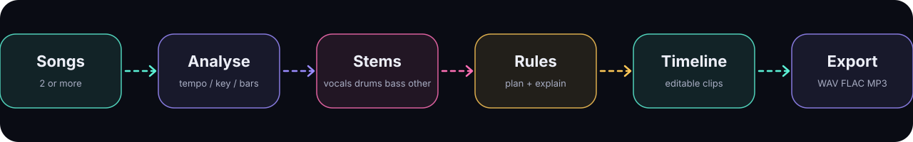

<!-- Generated by tools/readmes.py; edit docs/i18n/locales/ko.json. -->

  
  <h3>두 곡이 들어가고, 하나의 합금이 나옵니다.</h3>
  
규칙 기반 자동 매시업, 슬로우드 + 리버브, 로파이를 위한 오픈소스 데스크톱 스튜디오. 실제 타임라인 편집기를 갖추고 있습니다.

  

    
    
    
    
    
    
  

  
<a href="#demo">실제 동작 보기</a> · <a href="#what">기능</a> · <a href="#start">시작하기</a> · <a href="#rules">매시업 규칙</a> · <a href="#bench">벤치마크</a> · <a href="#paper">연구 논문</a>

---

 

## 🎬 실제 동작 보기

인트로, 가져오기, 자동 분석, Forge, 순차 믹스, 원클릭 Slowed + Reverb, 내보내기.

## ✨ 기능

| | |
|---|---|
| 🎛️ **Forge: 자동 매시업** | 두 곡 이상을 고르세요. Auralloy가 템포와 조성을 맞추고, 곡을 차례로 재생하며 비트를 맞추고 전환마다 부드럽게 블렌드합니다. |
| 🔎 **설계부터 설명 가능** | 모든 결정은 문서화된 규칙을 따르고 쉬운 말로 기록됩니다. 블랙박스가 없습니다. |
| 🎚️ **Studio: 진짜 편집기** | 멀티트랙 타임라인: 스냅, 분할, 트림, 페이드, 리버스, 클립별 게인, 템포와 피치, 루프 구간, 무제한 실행 취소. |
| 🌧️ **Slowed + reverb 와 lofi** | 원클릭 룩과 전체 이펙트 랙: EQ, 로파이 테이프, 컴프레서, 코러스, 에코, 리버브, 스테레오 폭, 빗소리, 바이닐. |
| 💎 **고품질 내보내기** | WAV 16/24/32비트 float, FLAC, MP3, 44.1~96 kHz, 32비트 float 처리. |
| 🧪 **공개 및 검증됨** | AGPL-3.0, 헤드리스 테스트, 시드 고정 벤치마크 모음, 연구 프리프린트. |

## 🧭 작동 방식

1. 템포, 비트, 마디, 조성, 구간을 분석합니다.
2. 스템을 분리합니다: 보컬, 드럼, 베이스, 기타.
3. 매시업 규칙으로 편곡을 계획하고 로그를 기록합니다.
4. 템포와 피치를 맞춰 각 클립을 렌더링합니다.
5. 편집: 모든 것이 타임라인의 일반 클립입니다.

## 🚀 시작하기

1. Releases에서 <b>Auralloy-0.0.1-windows-x64.zip</b>을 받아 <code>Auralloy.exe</code>를 실행하세요.
2. 두 곡 이상을 창에 끌어다 놓으세요.
3. <b>Forge</b>를 열고 구슬을 누르면 곡들이 차례로 재생됩니다.
4. 타임라인에서 편집하고 룩을 고른 뒤 <b>Export</b> 하세요.

> 빌드 방법, 단축키, 기술 문서는 영어 README에 있습니다.

## 📐 매시업 규칙

Forge는 명시적 규칙을 따르며 모든 결정을 쉬운 말로 기록합니다.

- 공통 템포 하나, 타임 스트레칭은 최소로.
- 공통 조성 하나(A 마이너는 C 메이저와 같음), 피치 이동은 최소로.
- 모든 컷은 첫 박에서, 4마디 프레이즈 단위로.
- 한 번에 보컬 하나와 베이스 하나; 베이스는 마디선에서 교체.
- 에너지로 구간을 맞추고, 2~8마디로 블렌드.
- 각 곡은 자체 밸런스를 유지하고 음량을 맞춥니다.

## 🖥️ 대시보드 둘러보기

 Studio: 곡 리본, 역할별 레인, 이펙트 랙.

 Forge: 덱, 호환성 매트릭스, 계획.

 Export: WAV, FLAC, MP3, 노멀라이즈, 디더.

## 📊 벤치마크

시드 고정, 합성 데이터, 재현 가능(benchmarks/ 참고). 실제 음악은 더 복잡합니다.

| | |
|---|---:|
| 템포 오차 0.5 % 이내 | **93.8 %** |
| 조성 일치 또는 관계조 | **99.0 %** |
| 첫 박 오차 50 ms 이내 | **85.4 %** |
| 구간 경계 (F1) | **0.71** |
| 규칙 준수율 | **100.0 %** |
| 렌더 후 템포 오차 | **0.010 BPM** |
| 단순 크로스페이드 대비 템포 드리프트 | **0.05 vs 3.07 BPM** |

96 songs · 45 planned mashups · stems SI-SDR vocals 21.9 dB, drums -0.3 dB, bass 6.9 dB · seed 20261101

## ⚠️ 솔직한 한계

- 대체로 일정한 4/4 템포를 가정합니다.
- Quick Stems는 고전적 DSP이며 신경망 분리기가 아닙니다.
- 화성이 모호하면 조성 감지가 틀릴 수 있습니다.
- 합성 곡으로 검증했으며 실제 음악은 더 많은 테스트가 필요합니다.

## 📄 연구 논문

**Auralloy: Rule-Grounded, Explainable Multi-Song Mashup Generation with an Editable Stem Timeline**  
C. M. Jubayer Hossain Bappy · 2026

방법과 평가를 설명하는 연구 프리프린트를 Zenodo용으로 준비했습니다. 동료 심사를 거치지 않았습니다.

## ⚖️ 라이선스

AGPL-3.0 (JUCE 기반). Auralloy는 도구입니다. 가져오는 오디오의 권리는 사용자 책임입니다.

© C. M. Jubayer Hossain Bappy · <a href="../../LICENSE">AGPL-3.0</a>

