<!-- Generated by tools/readmes.py; edit docs/i18n/locales/vi.json. -->

  
  <h3>Hai bài hát vào, một hợp kim ra.</h3>
  
Studio máy tính mã nguồn mở để tạo mashup tự động theo quy tắc, slowed + reverb và lofi, kèm trình chỉnh sửa timeline thực thụ.

  

    
    
    
    
    
    
  

  
<a href="#demo">Xem hoạt động</a> · <a href="#what">Làm được gì</a> · <a href="#start">Bắt đầu</a> · <a href="#rules">Quy tắc mashup</a> · <a href="#bench">Điểm chuẩn</a> · <a href="#paper">Bài nghiên cứu</a>

---

 

## 🎬 Xem hoạt động

Mở đầu, nhập bài, phân tích tự động, Forge, bản mix nối tiếp, Slowed + Reverb một cú nhấp, xuất file.

## ✨ Làm được gì

| | |
|---|---|
| 🎛️ **Forge: mashup tự động** | Chọn hai bài hát trở lên. Auralloy khớp nhịp độ và giọng, rồi phát lần lượt từng bài, khớp nhịp, với chuyển tiếp mượt ở mỗi lần đổi bài. |
| 🔎 **Giải thích được ngay từ thiết kế** | Mỗi quyết định theo một quy tắc bằng văn bản và được ghi lại bằng ngôn ngữ dễ hiểu. Không có hộp đen. |
| 🎚️ **Studio: trình chỉnh sửa thực thụ** | Timeline nhiều track với bắt dính, cắt, tỉa, fade, đảo ngược, gain từng clip, nhịp độ và cao độ, vùng lặp và hoàn tác không giới hạn. |
| 🌧️ **Slowed + reverb và lofi** | Kiểu âm thanh một cú nhấp và giàn hiệu ứng đầy đủ: EQ, băng lofi, compressor, chorus, echo, reverb, độ rộng, tiếng mưa và đĩa than. |
| 💎 **Xuất chất lượng cao** | WAV 16/24/32-bit float, FLAC và MP3 từ 44,1 đến 96 kHz, xử lý bằng 32-bit float. |
| 🧪 **Mở và đã kiểm thử** | AGPL-3.0, kiểm thử không giao diện, bộ benchmark có seed cố định và bản preprint nghiên cứu. |

## 🧭 Cách hoạt động

1. Phân tích nhịp độ, nhịp, ô nhịp, giọng và các đoạn.
2. Tách stem: giọng hát, trống, bass, còn lại.
3. Lập kế hoạch phối theo quy tắc mashup và ghi nhật ký.
4. Render từng clip với nhịp độ và cao độ đã khớp.
5. Chỉnh sửa: mọi thứ đều là clip bình thường trên timeline.

## 🚀 Bắt đầu

1. Tải <b>Auralloy-0.0.1-windows-x64.zip</b> từ Releases rồi chạy <code>Auralloy.exe</code>.
2. Kéo thả hai bài hát trở lên vào cửa sổ.
3. Mở <b>Forge</b> và bấm vào quả cầu: các bài hát phát nối tiếp nhau.
4. Chỉnh sửa trên timeline, chọn một kiểu, rồi <b>Export</b>.

> Hướng dẫn build, phím tắt và tài liệu kỹ thuật có trong README tiếng Anh.

## 📐 Quy tắc mashup

Forge tuân theo các quy tắc rõ ràng và ghi nhật ký bằng ngôn ngữ dễ hiểu cho mọi quyết định.

- Một nhịp độ chung, kéo giãn thời gian ít nhất.
- Một giọng chung (La thứ tương đương Đô trưởng), dịch cao độ nhỏ nhất.
- Mọi điểm cắt rơi vào phách mạnh, theo cụm 4 ô nhịp.
- Mỗi lúc chỉ một giọng hát và một bass; bass đổi ở vạch ô nhịp.
- Ghép đoạn theo năng lượng; chuyển tiếp từ 2 đến 8 ô nhịp.
- Mỗi bài giữ cân bằng riêng và độ to được làm đều.

## 🖥️ Tham quan bảng điều khiển

 Studio: dải bài hát, làn theo vai trò, giàn hiệu ứng.

 Forge: deck, ma trận tương thích và kế hoạch.

 Export: WAV, FLAC, MP3, chuẩn hóa, dither.

## 📊 Điểm chuẩn

Có seed cố định, tổng hợp và tái lập được (xem benchmarks/). Nhạc thật sẽ phức tạp hơn.

| | |
|---|---:|
| Nhịp độ trong 0,5 % | **93.8 %** |
| Giọng đúng hoặc giọng song song | **99.0 %** |
| Phách mạnh trong 50 ms | **85.4 %** |
| Ranh giới đoạn (F1) | **0.71** |
| Tuân thủ quy tắc | **100.0 %** |
| Sai số nhịp độ sau khi render | **0.010 BPM** |
| Trôi nhịp so với crossfade đơn giản | **0.05 vs 3.07 BPM** |

96 songs · 45 planned mashups · stems SI-SDR vocals 21.9 dB, drums -0.3 dB, bass 6.9 dB · seed 20261101

## ⚠️ Hạn chế một cách trung thực

- Giả định nhịp 4/4 khá ổn định.
- Quick Stems là DSP cổ điển, không phải bộ tách bằng mạng nơ-ron.
- Phát hiện giọng có thể sai khi hòa âm mơ hồ.
- Đã kiểm chứng trên bài tổng hợp; nhạc thật cần thử nghiệm thêm.

## 📄 Bài nghiên cứu

**Auralloy: Rule-Grounded, Explainable Multi-Song Mashup Generation with an Editable Stem Timeline**  
C. M. Jubayer Hossain Bappy · 2026

Một bản preprint nghiên cứu mô tả phương pháp và đánh giá đã được chuẩn bị cho Zenodo. Chưa qua bình duyệt.

## ⚖️ Giấy phép

AGPL-3.0 (xây dựng trên JUCE). Auralloy là một công cụ: bạn chịu trách nhiệm về bản quyền của âm thanh bạn nhập vào.

© C. M. Jubayer Hossain Bappy · <a href="../../LICENSE">AGPL-3.0</a>

